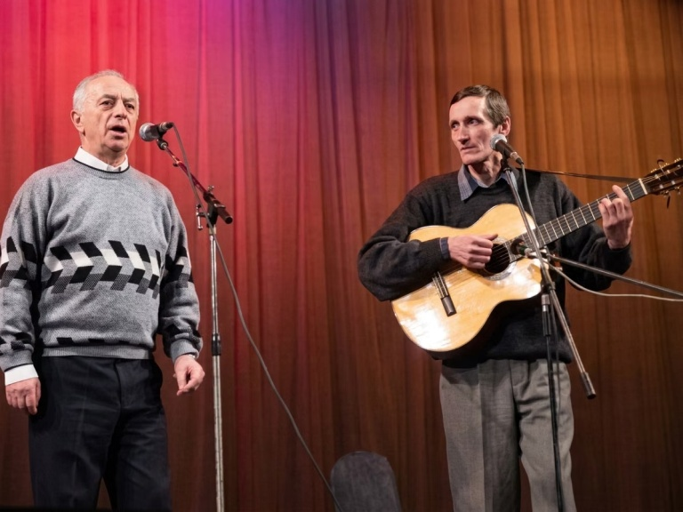

# Архив Александра Николаевича Костромина



<sub>Александр Костромин (справа, с гитарой) аккомпанирует Александру Городницкому, 2005.
Фото: Al Silonov, [CC BY 3.0](https://creativecommons.org/licenses/by/3.0/),
[Wikimedia Commons](https://commons.wikimedia.org/wiki/File:Gorodnitsky_and_Kostromin_restored.jpg).</sub>

**13.09.1951 — 03.10.2026.** Гитарист и педагог, многолетний руководитель гитарной школы и художественный
руководитель Московского центра авторской песни (ЦАП), ведущий вечеров «Споём вместе!»,
аккомпаниатор Александра Городницкого, Александра Дулова, Евгения Аграновича.

Здесь собраны его тексты — сообщения на форуме ЦАП, статьи, доклады, учебные материалы гитарной
школы — и расшифровки его лекций и концертов. Архив сделан в память о нём: чтобы его мысли,
манера объяснять и юмор оставались доступны ученикам и друзьям.

## Что внутри

| Каталог | Что это | Объём |
|---|---|---|
| `persona/portrait.md` | Портрет: биография, манера речи, взгляды — с цитатами | — |
| `texts/articles/` | Статьи, доклады на Теоретических чтениях, выступления | 21 |
| `texts/teaching/` | Методика гитарной школы: пособия, теория, репертуар | 53 |
| `texts/interviews/` | Интервью: вопросы журналистов и его ответы | 1 |
| `texts/talks/` | Расшифровки лекций и концертов (2009–2026) | 26 |
| `texts/about/` | **Говорят о нём**: воспоминания и свидетельства учеников, друзей, коллег — дословно, с автором и ссылкой | 10 |
| `texts/forum/<год>/` | Его сообщения на форуме ksp-msk.ru, по темам (2006–2026) | 1036 тем, 2942 сообщения |
| `texts/index.jsonl` | Метаданные всех документов, по строке на документ | — |
| `llms.txt` | Оглавление архива со ссылками на все документы | — |
| `photos/` | Фотографии со свободными лицензиями (авторы и лицензии — в `photos/README.md`) | 2 |

Всего около 890 тысяч слов (≈14 МБ текста).

## Формат

Каждый документ — отдельный Markdown-файл с YAML-шапкой:

```markdown
---
id: "forum-topic-4869"
type: "форум"              # форум | статья | методика | расшифровка
title: "28 ноября 2014 в ЦАПе концерт Виты Левинсон"
date: "2014-11-21"         # дата первого сообщения / события
url: "http://www.ksp-msk.ru/forum/viewtopic.php?t=4869"
topics: ["история_КСП", "личное_и_воспоминания"]
voice_max: 3               # 0–3: насколько ярко в теме видна его манера
---

## 2014-11-21 · сообщение 39108
...
```

- **Форум.** Один файл — одна тема; внутри его сообщения по порядку, каждое со ссылкой на оригинал.
  Если он отвечал кому-то или цитировал — чужой текст приведён цитатой (`>`) с именем автора.
  Пересланные им чужие публикации (пресс-релизы, письма) в архив не включены.
- **Расшифровки.** Автоматические (модель Gemini), с разметкой говорящих: `КОСТРОМИН`, имена,
  `ЗАЛ`, `ДРУГОЙ`. Песни указаны одной строкой `[ПЕСНЯ: …]`. Время — от начала записи;
  ссылка на видео с нужной минутой: `<url>&t=<секунды>s`. **Возможны ошибки распознавания** —
  при цитировании сверяйтесь с записью.
- **Сканы.** Несколько статей распознаны со сканов автоматически — это отмечено в начале файла.

`id` документов стабильны между обновлениями, поэтому в истории git видны только реальные изменения.

## Тексты публикуются без правок

Сообщения, статьи и выступления приводятся дословно, как они были написаны или произнесены, —
включая резкие оценки, полемику и высказывания о конкретных людях. Это слова Александра Николаевича
и его собеседников в спорах своего времени; мы не вправе их исправлять или смягчать.
Цитаты других людей помечены и подписаны. Единственное, что изменено, — личные контакты
и реквизиты частных лиц (телефоны, личная почта, номера карт и счетов) заменены пометками
вида «[телефон скрыт]».

## Источники и права

- Форум и сайт Московского центра авторской песни — [ksp-msk.ru](https://www.ksp-msk.ru/).
- Видеозаписи — каналы YouTube «Центр Авторской Песни КСП», Boris Felikson, Twopizza22,
  electrik _, Oleg Pshenitsyn и другие; ссылка на каждую запись — в шапке файла.
- Статьи из журнала «Люди и песни» и книги И. Каримова «КСП» — в том виде, в каком они
  опубликованы на сайте ЦАП.

Права на тексты Александра Николаевича принадлежат его наследникам, на чужие цитаты — их авторам,
на записи — их авторам и владельцам каналов. Архив публикуется в некоммерческих мемориальных целях,
со ссылками на первоисточники; лицензия на повторное использование не предоставляется.
Если вы правообладатель или упомянутый человек и хотите что-то исправить или убрать — создайте issue
или напишите владельцу репозитория.

## Как обновляется

Архив генерируется скриптом из рабочего репозитория со сбором и обработкой данных
(сбор форума и сайта, расшифровка видео, проверка на дубли и целостность). Новые расшифровки
и исправления попадают сюда новыми коммитами; файлы в `texts/` и `llms.txt` создаются заново
при каждом экспорте — вручную их править не нужно, правки вносятся в источники.
